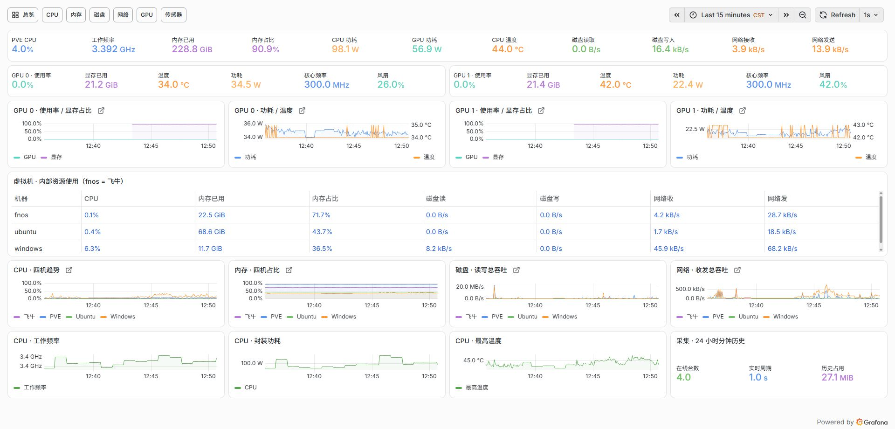
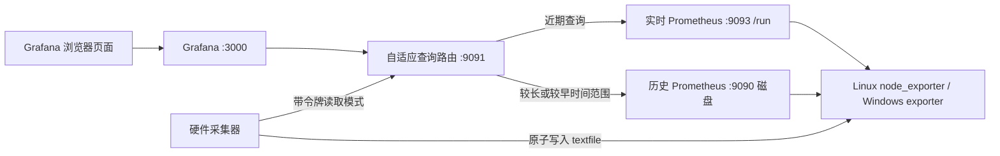

# PVE Task Manager

面向个人 PVE 环境的任务管理器风格性能监控：Grafana 紧凑大屏、Prometheus 双通道存储，以及按页面查询活动自动切换的采集频率。

覆盖 **PVE 宿主机、Ubuntu、Windows 和飞牛 fnOS**。显示 CPU 利用率/工作频率、实际内存、磁盘、网络、GPU、温度与可读取的功耗；虚拟机配置容量与系统内部实际使用量分别展示。OpenWrt 不在本模板的监控范围内。

这是从实际运行部署整理的公开源码和配置模板，包含当前高密度布局。它仍是针对四种固定机器角色和两张 NVIDIA GPU 的个人项目，需要按部署文档填写地址、VM ID 和私有凭据；不是无需配置的一键安装产品。



## 功能

- PVE 主要指标合并一排；两张 GPU 左右对照；三个客体的实际占用合并表格。
- 总览 11 张趋势图，覆盖 CPU、内存、磁盘、网络、频率、温度和功耗。
- 96 逻辑 CPU 示例使用 12 列 × 8 行小图，共用时间范围和量程，复用查询结果。
- 卡片数值 20 px、标签 12 px；以 1920 × 920 浏览区域验收。
- 有面板查询时，实时通道约 1 秒采集；连续 60 秒无查询后回到 60 秒。
- 历史通道始终每 60 秒采集，保留目标 24 小时；秒级实时通道使用 `/run` 内存文件系统。
- 按约 100 MB 的历史数据与日志预算设计，但没有文件系统硬配额保证。
- CPU/GPU/BMC/SMART 数据附带采集状态和新鲜度判断，失效时显示缺失，而不是伪装成实时值。

## 架构



## 文档入口

| 文档 | 内容 |
|---|---|
| [技术原理](docs/architecture.md) | 双 Prometheus、活动检测、路由、线程和新鲜度 |
| [指标口径](docs/metrics.md) | CPU/内存/频率/功耗/磁盘/网络的公式与边界 |
| [部署指南](docs/deployment.md) | 依赖、模板生成、Linux/Windows 采集器和服务安装 |
| [运行维护](docs/operations.md) | 验收、备份、降频检查、排错、资源预算 |
| [设计取舍与限制](docs/limitations.md) | 固定角色、权限、存储、查询和硬件适配限制 |
| [第三方组件](docs/third-party.md) | 版本基线、上游文档和依赖许可 |

## 本地生成与检查

Python 3.11+，仅使用标准库：

```sh
python scripts/build_dashboards.py
python -m unittest discover -s tests -v
python scripts/check_public.py
```

`dashboards/` 已提交生成结果，可查看或导入 Grafana；完整部署请读部署指南。只导入 JSON 不会自动创建采集器、聚合规则和自适应路由。

```text
src/                     硬件采集器、自适应路由、布局生成器
dashboards/              七个 Grafana 仪表盘和 Prometheus 聚合规则
config/                  脱敏模板、systemd 服务、Grafana provisioning
scripts/                 生成、配置渲染、安装辅助、备份和验证
tests/                   配置生成和运行逻辑检查
docs/                    架构、指标、部署、运维和截图
```

公开仓库不包含实际服务器地址、登录密码、令牌、Grafana 数据库或运行数据。截图用于展示界面与指标类型。

初始整理日期：2026-10-19。当前实际部署的核心功能已运行验收；公开版新增的参数化配置工具经过本地测试，尚未在全新机器上做完整重装验收。

